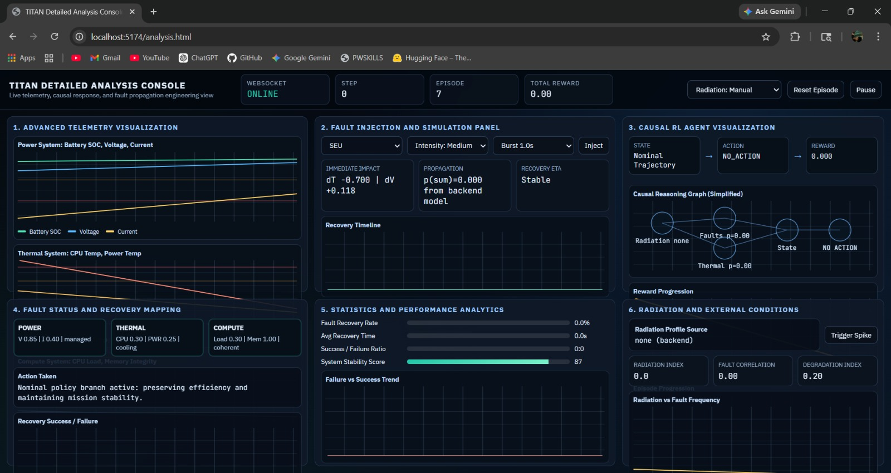
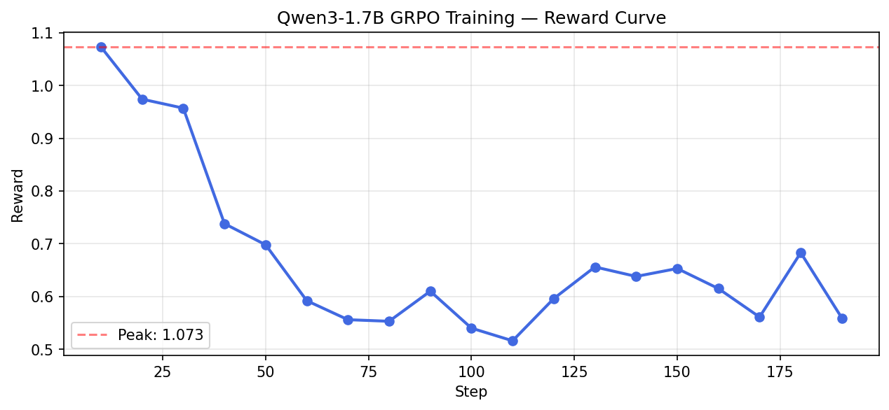
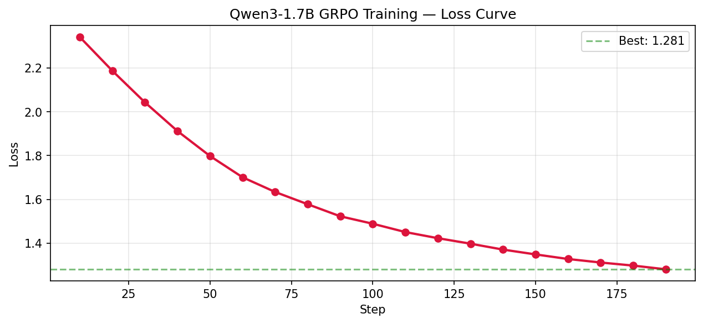

# TITAN: Deciding When to Look Before You Act

> **TL;DR:** **titan-env** is a satellite fault-recovery OpenEnv where the agent can't see what's actually broken — only symptoms. The key design decision: give the agent a `diagnose` action that costs reward but reduces uncertainty. What falls out is a policy that learns when to look before it acts.

> **Links:**
> - Repository README: [README.md](README.md)
> - Demo video (YouTube): [https://youtu.be/AEybAPoSk48](https://youtu.be/AEybAPoSk48)

---

A satellite is in eclipse. `cpu_temp` reads `0.62` — within thermal envelope, no flag set. `power_temp` has crept up by `0.04` over the last twelve steps. `current_draw` is wandering in a way that doesn't quite match the duty cycle. There is no fault flag in the observation. Nothing is *wrong* in the usual sense. Something is *becoming* wrong.


*The TITAN analysis console: live telemetry, fault injection, causal-agent state, and recovery statistics in one view.*

This is the kind of state TITAN was built for. Not the obvious failure where memory integrity collapses to `0.2` and the right answer is "scrub memory." The harder one — where the agent is staring at a smear of borderline numbers and has to choose between **acting**, **waiting**, and **asking the system to tell it more**.

---

## Why This Is Hard

A common framing for "satellite control" is closed-loop control: observe a state, pick a corrective action, world responds. TITAN deliberately breaks this.

Two things break the textbook setup.

**The observation is not the state.** TITAN maintains true latent fault flags — `seu_flag`, `latchup_flag`, `thermal_fault_flag`, `memory_fault_flag`, `power_fault_flag` — and the public observation strips them. The agent sees `voltage`, `current_draw`, `battery`, `cpu_temp`, `power_temp`, `memory`, `cpu_load`, `signal`, `recent_fault_count`. The fault is in the world; only its symptoms reach the agent.

**The same observation can mean different things.** Take a single step:

```
cpu_temp = 0.71   power_temp = 0.58   current_draw = 0.62
memory   = 0.78   battery    = 0.55   recent_fault_count = 0.4
```

That reading is consistent with at least three latent states:

- A thermal runaway just starting (`cpu_temp` leading, `power_temp` following)
- A latch-up that pushed `current_draw` and bled into thermal
- A memory corruption with collateral effects on load and heat

A snapshot can't separate these. A short *trend* often can — `cpu_temp` rising before `power_temp` looks different from both rising together — but only if the policy is willing to keep a short memory and reason over it. Treating each step as fresh telemetry erases the only signal that disambiguates.


*The live mission view: Earth, sun, and satellite alongside the same observation channels (`Battery SOC`, `Voltage`, `CPU Temp`, `Power Temp`, `Memory Integrity`) and the latent fault categories (`SEU`, `Latch-up`, `Thermal Runaway`, `Memory Fault`, `Power Fault`) that the agent has to infer from those numbers.*

---

## System Design

The simulation core is a discrete-time subsystem model with a fixed step cycle:

1. **`FaultInjector.sample(state, t)`** — Bernoulli draws over five fault types using state-dependent rates (`p_thermal_runaway` rises with `cpu_temp − 0.70`; `p_latchup` scales with radiation × `power_temp`; and so on).
2. **`ActionProcessor.apply(action, state)`** — the chosen action mutates the true state.
3. **`StateTransition.step(state)`** — physics propagates: thermal, electrical, memory drift, noise.
4. **`check_failure(...)`** — terminate if a hard bound is crossed.
5. **`_get_observation(...)`** — project to the public observation, hiding the latent flags.

The action set has eight commands:
`no_action`, `reset`, `memory_scrub`, `load_shedding`, `power_cycle`, `thermal_throttle`, `isolate`, `diagnose`. Seven change the world. One — `diagnose` — does not.

The reward is multi-objective and normalized:

```python
R = w1·uptime − w2·fault_severity − w3·energy_usage
      − w4·recovery_latency − w5·action_cost
```

`w5` is small (`0.05`), but non-zero. That small term is what makes "do something just in case" a measurably bad strategy over a long episode. Acting without information is taxed; doing nothing while the world degrades is taxed harder (`uptime` collapses, `fault_severity` rises). Between them sits a narrow optimum where buying information becomes worth its cost.

---

## The Role of DIAGNOSE

`diagnose` doesn't fix anything. It doesn't change voltage, temperature, or memory. Mechanically, it is a no-op on the true state. Its only product is information: a tighter posterior over which latent fault is active.

The first instinct, when you see a no-op action that costs reward, is to delete it. The reason it earns its place is the asymmetry of the alternatives. For the ambiguous reading above, the reactive responses are:

| Action | Right for | Wrong for |
|--------|-----------|-----------|
| `thermal_throttle` | Thermal runaway | Latch-up, memory corruption |
| `power_cycle` | Latch-up | Thermal (drains battery, resets voltage) |
| `memory_scrub` | Memory corruption | The other two |

Guess wrong and you haven't just failed to fix the fault. You've spent reward, moved the state, and the *next* observation is now harder to interpret because *your* action perturbed it. Mistakes compound.

A reactive policy treats every borderline reading as an emergency. A diagnosing policy treats borderline readings as **ambiguous**, and treats ambiguity as a state worth resolving before paying for an irreversible move.

---

## Making Decisions Visible

A line on a graph doesn't show *why* the agent did what it did. The decision panel is built so it does.

For each step, the panel surfaces:

- **Observation** — the same values the policy receives, with short trend arrows so a rising `cpu_temp` looks different from a steady one.
- **Uncertainty** — which faults are plausible given the recent window, and a confidence label (`low | medium | high`).
- **Decision** — the chosen command, in plain text.
- **Justification** — the expected primary effect (a state variable and direction) and one concrete risk if the call is wrong.

Watching this panel during an episode changes how you read the system. Telemetry shows `cpu_temp` rise. The decision panel shows the same rise plus *the agent waited two steps, ran `diagnose`, then committed to `thermal_throttle`.* The behavior becomes legible. You can disagree with it, but you can see it.

The simulator without this lens is hard to trust; the lens without the simulator has nothing to show.

---

## Example Trajectory

Task `medium_thermal_stabilization`, seed 42. Four steps that contain the entire argument.

**Step 14 — `no_action`**
`cpu_temp=0.58`, `power_temp=0.51`, `battery=0.74`, `memory=0.96`, `recent_fault_count=0.1`. Both thermals up `~0.03` over the last five steps. Drift is small, ambiguity low, intervention cost outweighs expected gain. Wait.

**Step 17 — `diagnose`**
`cpu_temp=0.66`, `power_temp=0.57`, `current_draw=0.61`, `recent_fault_count=0.2`. Thermals drifting together while `current_draw` climbs. That triplet is consistent with either an emerging thermal runaway or a slow power-side fault. The agent doesn't commit. It buys information.

**Step 18 — `thermal_throttle`**
`cpu_temp=0.69`, `power_temp=0.59`. Post-diagnose, the policy commits: `cpu_temp` is leading `power_temp`, and `current_draw` rose proportionally to `cpu_load` rather than independently — pattern matches thermal, not power.

**Step 21 — `no_action`**
`cpu_temp=0.61`, `power_temp=0.53`, `recent_fault_count=0.1`. Trajectory has bent. Let the system relax.

A reactive baseline on the same seed fired `power_cycle` at step 17, dropped `battery` to `0.61`, briefly tripped `power_fault_flag` — now the world has a *real* power fault that wasn't there before — and spent the rest of the episode climbing back toward nominal. Same observation history, different policy, worse outcome. The failure traces to one decision: acting on a guess instead of buying a step of information.

---

## Training (evidence)

The policy is **Qwen3-1.7B** fine-tuned with **GRPO** (via Unsloth + Hugging Face TRL) on the multi-objective reward above. Curves below are from a real run; both files live in `docs/` of the repo.

| Reward (training) | Loss (training) |
|-------------------|-----------------|
|  |  |

The shape is unsurprising: reward rises and stabilizes once the policy stops paying for blind interventions, loss decays as the action distribution concentrates on the (few) actually-useful commands per regime.

---

## What Actually Matters

Two narrow claims, stated so they don't drift into philosophy.

**Partial observability is the design parameter, not a curiosity.** The moment you hide the fault flags, the optimal policy stops being a lookup table from telemetry to action. It becomes a small inference problem with an explicit information-gathering action attached. TITAN makes that structure concrete in a domain where the cost of guessing is intuitive: you can feel the wasted battery.

**Trends are state.** A single observation `cpu_temp = 0.65` is not the same situation as `cpu_temp = 0.65` reached after a five-step climb from `0.55`. The latter has nonzero probability of thermal runaway; the former is operating warmth. TITAN doesn't expose this difference as a separate channel — it forces the policy (or the human reading the dashboard) to keep its own short memory and reason over it. That alignment between what the policy must learn and what an operator would actually reason about is the point.

---

## Limitations

Honest list.

**The physics is a model, not a satellite.** `cpu_temp`, `power_temp`, and `battery_soc` are normalized scalars, not the output of a real thermal/electrical solver. Tuned to be informative, not certified. Anyone using TITAN as a pre-flight tool would replace the core with their own subsystem model.

**Fault taxonomy is small.** Five active fault types plus telemetry corruption. Real spacecraft have many more failure modes, and they correlate in ways the current `FaultInjector` doesn't capture.

**`diagnose` is abstract.** In the simulator it doesn't probe a specific subsystem; it just doesn't move the world. A more honest version would let the agent choose *what* to diagnose, with different costs and different posterior gains. Planned, not present.

**The trained policy is small.** A 1.7B LoRA over Qwen3, fine-tuned with GRPO on the multi-objective reward. Enough to surface emergent diagnostic behavior; not the policy you'd deploy. A larger model or a dedicated POMDP planner would do better on the harder seeds.

**Hard-failure tasks remain hard.** On `hard_multi_fault_survival`, even the GRPO policy lives at a noticeably lower score than on `easy` and `medium`. Compounding faults break the assumption that one `diagnose` resolves the ambiguity.

These are the next several months of work, not blockers.

---

## Closing

The narrow claim is that you can build an environment where intelligent behavior — not raw responsiveness, but the willingness to pause and ask — falls out of two design decisions: hiding the true fault state and pricing every action.

The broader reason this matters is that real autonomous systems, in orbit or in a vehicle or behind an operations console, spend most of their time in exactly this regime. The fault is rarely labeled. The action is rarely free. The right move is often to look more carefully before committing.

**titan-env** is a small environment that takes those constraints seriously, and a small frontend that makes the resulting decisions visible. Both pieces are necessary.

---

*Code and environment live in this repository (`titan-env` package, OpenEnv entry **`TITAN`**). Model weights are not committed to the repo; see the setup notes in [README.md](README.md) for installation and task configs.*

*Demo video: [https://youtu.be/AEybAPoSk48](https://youtu.be/AEybAPoSk48).*
